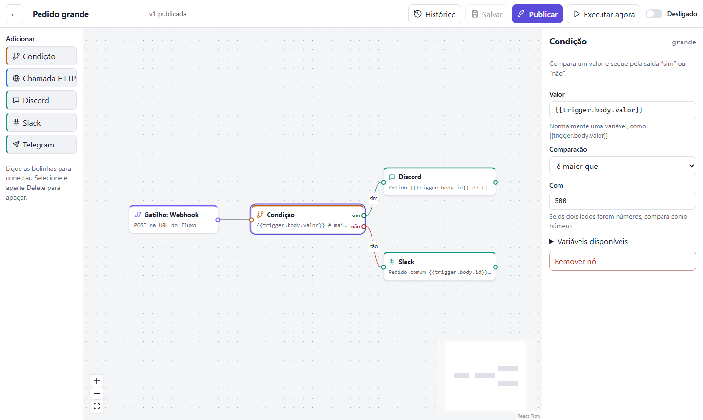
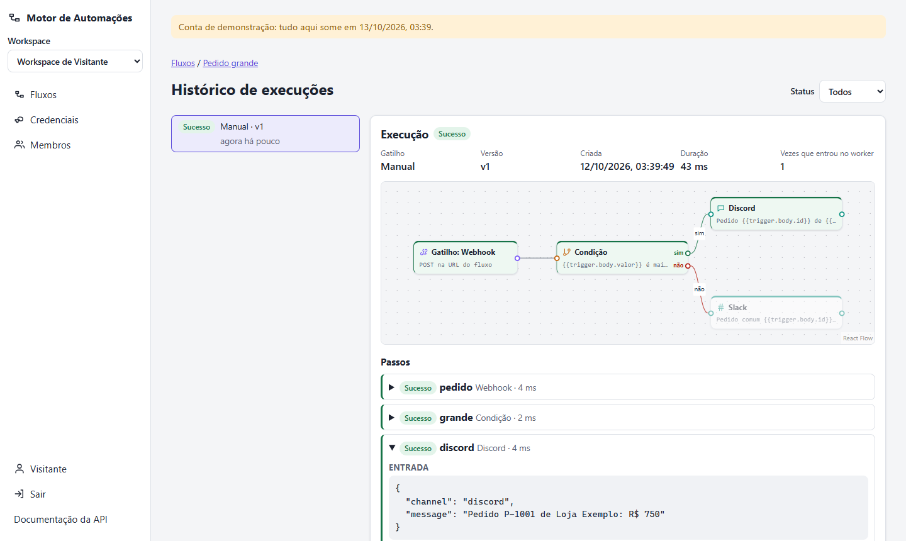
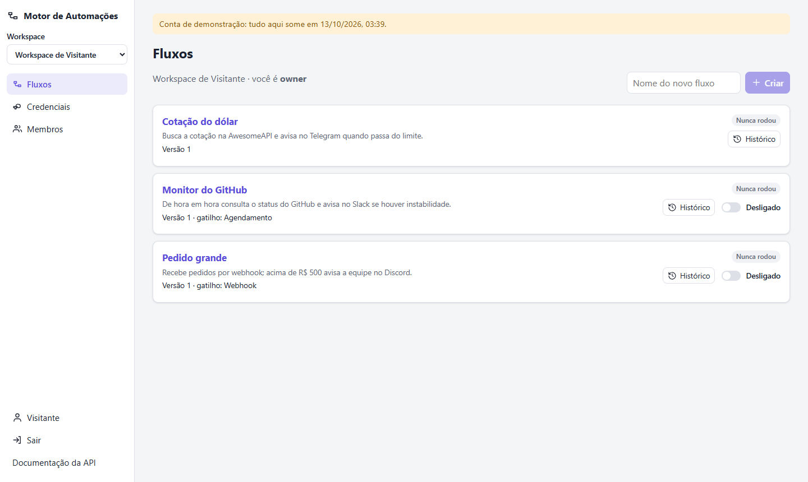

# Motor de Automações

Fluxos de automação visuais (gatilho → condição → chamada de API → aviso no Discord, Slack ou Telegram) **executados de verdade**: fila no PostgreSQL, novas tentativas automáticas, agendamento e histórico de cada passo.

**Demo:** ainda não publicada (deploy no Render + Neon pronto no `render.yaml`). Para rodar agora, veja [Rodando](#rodando). Lá dá para clicar em **Experimentar sem cadastro**: a conta temporária, de 24 h, já vem com três fluxos de exemplo.

<p>
  
</p>
<p>
  
  
</p>

**Stack:**
- **Back:** Node 22 · Express 5 · TypeScript · PostgreSQL 16 (SQL puro com `pg`, RLS) · Zod · undici
- **Front:** React 19 · React Flow (`@xyflow/react`) · TanStack Query · React Router · Vite
- **Testes e entrega:** `node:test` + Vitest + Testing Library · Docker · GitHub Actions

## Funcionalidades

- **Editor visual** em React Flow:
  - gatilho (webhook, agendamento com cron e fuso, ou manual), condição com saídas "sim" e "não", chamada HTTP e notificações no Discord, no Slack e no Telegram;
  - variáveis entre os nós: `{{trigger.body.valor}}`, `{{steps.cotacao.body.USDBRL.bid}}`;
  - o editor não deixa criar ciclo nem ligar algo no gatilho, e os problemas que o servidor aponta aparecem no próprio nó.
- **Rascunho e versões:**
  - "Salvar" guarda o rascunho; "Publicar" cria uma **versão imutável**, que é o que roda;
  - cada execução guarda a versão que rodou, então editar o fluxo no meio não muda o que já está na fila.
- **Execução de verdade:**
  - a **fila é uma tabela do PostgreSQL**, e um worker pega as execuções com `FOR UPDATE SKIP LOCKED`;
  - quando uma chamada falha, **só aquele passo** é tentado de novo, com espera crescente (10 s, 20 s, 40 s… até 10 min) e respeitando o `Retry-After`;
  - os passos que já deram certo não rodam de novo: ninguém recebe a mesma notificação duas vezes.
- **Falha classificada:**
  - um 4xx ou uma URL bloqueada é erro de configuração e não tem nova tentativa;
  - timeout, falha de rede, 5xx e 429 são problemas do serviço de fora e são tentados de novo;
  - a mensagem diz qual dos dois aconteceu.
- **Histórico:**
  - o fluxo da execução aparece colorido pelo resultado de cada nó, com a entrada, a saída, o erro e a duração de cada tentativa;
  - a tela atualiza sozinha enquanto a execução roda;
  - dá para cancelar uma execução e filtrar por status.
- **Webhook público** (`POST /hooks/{token}`):
  - o cabeçalho `Idempotency-Key` faz um reenvio do mesmo evento devolver a mesma execução;
  - tem limite de corpo de 256 KB e rate limit por token e por IP.
- **Workspaces com equipe:**
  - papéis owner, editor e leitor;
  - convite por link (uso único, 7 dias) ou por e-mail;
  - o convite por e-mail responde igual com ou sem conta, então não revela quem está cadastrado.
- **Credenciais** (webhook do Discord ou do Slack, token do bot do Telegram, cabeçalho de API):
  - ficam criptografadas com AES-256-GCM e **ninguém vê o segredo depois de salvo**, nem o owner;
  - sem credencial, a notificação roda em modo de teste e a mensagem aparece só no histórico.
- **Conta:**
  - login com 2FA opcional (TOTP com QR code e códigos de recuperação);
  - **"Experimentar sem cadastro"**: conta de 24 h, sem pedir nenhum dado pessoal.
- **Pronto para publicar:**
  - ícones, manifest, Open Graph, JSON-LD (`WebApplication`), robots, sitemap, `llms.txt`, privacidade e 404 de verdade;
  - Lighthouse **99 / 100 / 100 / 100** na imagem de produção;
  - GA4 e Clarity só carregam depois do aceite (e só se os IDs estiverem configurados).

## Arquitetura

```
backend/
  migrations/001_inicial.sql   schema, RLS, papéis do banco, triggers (ver docs/banco.md)
  src/
    domain/        regras puras: definição do fluxo e validação do grafo, templates, condições, backoff, cron
    engine/
      queue.ts     fila na tabela executions: enfileirar (cota, idempotência), pegar (SKIP LOCKED), recuperar lease, agendador, limpeza
      worker.ts    roda uma execução passo a passo, com lease + fencing; retry por passo
      nodes.ts     executores (HTTP, Discord, Slack, Telegram, condição) e classificação da falha
      safe-http.ts cliente HTTP com proteção contra SSRF
    services/      publicar (versão + gatilhos), workspaces, fluxos de exemplo, limpeza de contas demo
    http/          Express: auth, workspaces, convites, credenciais, fluxos, webhook, OpenAPI, site
    db/pool.ts     asUser (RLS por usuário) e asSystem
frontend/src/
  flow/            catálogo de nós, conversão definição ↔ React Flow, nó do canvas, painel de configuração
  pages/           Editor, Execuções, Fluxos, Credenciais, Membros, Conta, Login, Convite
```

### Decisões

- **Fila no PostgreSQL, sem Redis.**
  - Enfileirar é um `INSERT` na mesma transação que valida o pedido. Não existe "gravou no banco mas o job sumiu".
  - Vários workers (ou várias instâncias) pegam itens com `SKIP LOCKED` sem esperar uns pelos outros e sem pegar o mesmo item.
  - É um serviço a menos para hospedar.
- **Lease com fencing.**
  - O worker marca `locked_until` e renova a cada passo; se o processo morrer (deploy, queda), o prazo vence e a execução volta para a fila.
  - Toda gravação confere `locked_by`, então um worker atrasado não grava por cima de quem assumiu.
  - A entrega é **pelo menos uma vez**: as chamadas HTTP levam `Idempotency-Key: <execução>:<nó>` para quem recebe poder ignorar repetição.
- **RLS por workspace com dois papéis do banco.** A aplicação nunca consulta como dono das tabelas (o dono não passa pelo RLS). Cada transação troca de papel com `SET LOCAL ROLE`:
  - `motor_app` atende o usuário logado, isolado pelo RLS via `app.user_id`;
  - `motor_system` cuida de login, webhook e worker.

  Mesmo uma consulta sem `WHERE` só enxerga o que é dos workspaces da pessoa.
- **O segredo da credencial é inacessível à API logada.** O papel `motor_app` não tem permissão de `SELECT` na coluna `secret_encrypted` (`GRANT` por coluna). Nem um bug com `SELECT *` devolve o segredo; só o worker decifra.
- **Proteção contra SSRF.** Quem monta o fluxo escolhe a URL, e a chamada sai do nosso servidor. Por isso:
  - o IP é conferido **depois de resolver o DNS, dentro da própria conexão** (o `lookup` do agente do undici). Um domínio que aponta para `127.0.0.1` ou `169.254.169.254` é barrado, inclusive se trocar de IP entre a checagem e a conexão (DNS rebinding);
  - os redirecionamentos são seguidos à mão, conferindo cada destino;
  - as portas são limitadas e a resposta tem teto de 1 MB.
- **Template sem `eval`.** As variáveis são só leitura de caminho em objeto (sem subir no protótipo). No corpo JSON, elas são resolvidas **dentro das strings depois do parse**: uma aspa vinda do webhook não quebra nem injeta campos no JSON enviado.
- **Agendamento perdido roda uma vez, não N.** Isso acontece quando o servidor dorme no plano grátis. A chave `schedule:<horário>` impede duas instâncias de criarem a mesma execução.
- **Cotas, porque a demo é pública e cada execução faz chamadas reais:**
  - 500 execuções/dia e 20 fluxos por workspace;
  - agendamento de no mínimo 5 minutos.

  A contagem da cota usa *advisory lock* por workspace, então pedidos simultâneos não passam juntos do limite.
- **Token do webhook e do convite: só o hash fica no banco.** A URL aparece uma vez e pode ser trocada. O link de convite leva o token no fragmento (`/convite#…`), que o navegador não manda ao servidor nem no `Referer`.
- **Worker no mesmo processo da API** (plano grátis do Render). A fila no banco já permite separar o worker num serviço próprio sem mudar código.

Bugs que os testes de concorrência acharam (e como foram corrigidos) estão em [`docs/banco.md`](docs/banco.md).

## Rodando

Precisa de Node 22 e Docker (para o PostgreSQL).

```bash
docker compose up -d db            # PostgreSQL na porta 5433, com dono sem superusuário (igual ao Neon)
cd backend && cp .env.example .env # troque JWT_SECRET e ENCRYPTION_KEY (openssl rand -hex 32)
npm install && npm run dev         # API + worker + agendador em http://localhost:3002 (migrações rodam sozinhas)
cd ../frontend && npm install && npm run dev   # http://localhost:5174
```

Documentação interativa da API: `http://localhost:3002/api/docs`.

Testar um webhook: publique e ligue o fluxo "Pedido grande", copie a URL e rode:

```bash
curl -X POST "http://localhost:3002/hooks/SEU_TOKEN" -H "Content-Type: application/json" -H "Idempotency-Key: pedido-1" -d '{"id":"P-1","cliente":"Loja","valor":750}'
```

## Testes

```bash
cd backend && npm test    # 51 testes contra PostgreSQL real (docker compose up -d db)
cd frontend && npm test   # 14 testes (Vitest + Testing Library)
```

- **Motor:**
  - caminho feliz e ramo falso;
  - retry de 503 e timeout sem repetir o que deu certo;
  - 404 sem retry, tentativas esgotadas;
  - credencial de outro workspace recusada;
  - idempotência com reenvios simultâneos e cota com pedidos simultâneos;
  - **4 workers em paralelo processando cada execução exatamente uma vez**;
  - worker que morre no meio, lease vencido e retomada (e o worker antigo sem conseguir gravar);
  - cancelamento;
  - agendador com duas instâncias ao mesmo tempo;
  - bug interno com mensagem genérica.
- **RLS:**
  - consulta sem filtro só vê o próprio workspace;
  - sem usuário não vê nada;
  - o segredo não sai nem para o owner;
  - viewer não escreve;
  - o workspace nunca fica sem owner, nem com dois rebaixamentos simultâneos;
  - versão publicada imutável.
- **SSRF:**
  - faixas privadas IPv4 e IPv6 (incluindo `::ffff:127.0.0.1`);
  - `localhost` resolvido pelo DNS barrado na conexão, contra um servidor local de verdade.
- **API:**
  - cadastro com fluxos de exemplo e conta demo;
  - do rascunho ao webhook (publicar, ligar, disparar, idempotência, girar o token, desligar);
  - corpo grande, JSON quebrado e método errado no webhook;
  - 422 apontando o nó;
  - credenciais validadas por serviço;
  - papéis, isolamento (404 e não 403) e convites;
  - paginação por cursor;
  - 2FA;
  - rate limit com `Retry-After`;
  - cabeçalhos de segurança;
  - robots, sitemap, noindex e 404 de verdade;
  - **teste que garante que toda rota está na OpenAPI**.
- **Front:**
  - conversão definição ↔ React Flow e validação de conexões;
  - "voltar" do login contra open redirect;
  - painel do nó (operadores, credencial do tipo certo, JSON inválido não é gravado, leitor só lê);
  - consentimento LGPD.

O CI roda typecheck, testes (com o banco criado por um dono sem superusuário), build e o build da imagem Docker a cada push, além do gitleaks em todo o histórico.

## Deploy (Render + Neon)

1. **Neon:**
   - crie um banco e copie a connection string **direta** (sem `-pooler`), com `?sslmode=require`;
   - a migração usa *advisory lock* de sessão, que o pooler em modo transação não mantém.
2. **Render:**
   - New + → **Blueprint** → este repositório; o `render.yaml` cria o serviço Docker;
   - `JWT_SECRET` e `ENCRYPTION_KEY` são gerados sozinhos;
   - cole o `DATABASE_URL`.
3. O endereço público (webhooks, convites, canonical) vem sozinho do `RENDER_EXTERNAL_URL`.

As migrações rodam na subida. O plano grátis dorme depois de 15 min sem acesso; o agendamento perdido nesse tempo roda uma vez quando o servidor acorda.

## Autor

Ademar C. Neto · [GitHub](https://github.com/AdemarChamiNeto) · [Portfólio](https://ademarchamineto.github.io)
